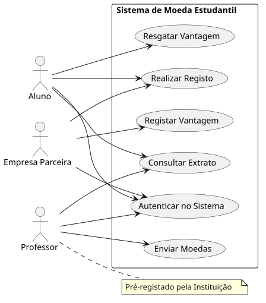
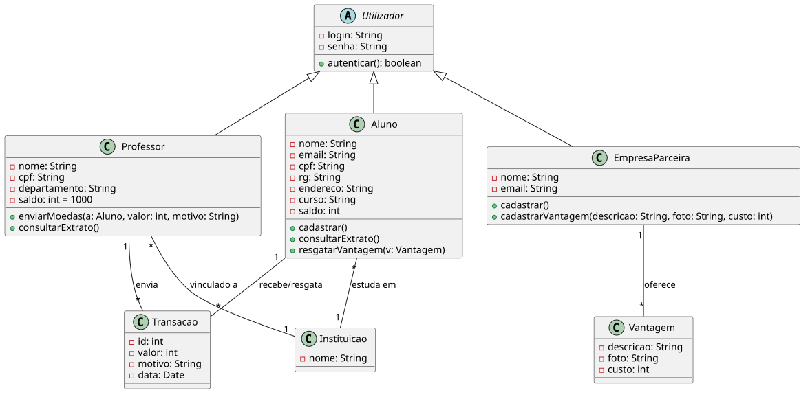
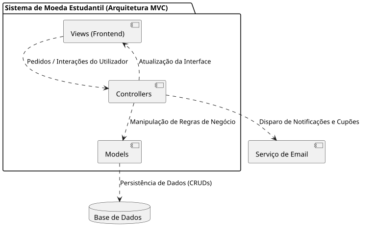

# 🎓 Sistema de Moeda Estudantil

> **Pontifícia Universidade Católica de Minas Gerais (PUC Minas)**  
> **Curso de Engenharia de Software**  
> **Disciplina**: Laboratório de Desenvolvimento de Software / Projeto de Software (Lab 3 - 2º Semestre/2026)  
> **Docente**: Profa. Milena Menezes Adão  

[](https://www.pucminas.br)
[](#-arquitetura-do-sistema)
[](docs/sprints.md)
[](docs/modelagem.md)
[](docs/README.md)

---

## 📖 Visão Geral do Projeto

O **Sistema de Moeda Estudantil** é uma plataforma desenvolvida para incentivar e reconhecer o mérito acadêmico dos estudantes universitários por meio de uma moeda virtual. 

A moeda virtual é distribuída semestralmente pelos professores aos alunos como forma de reconhecimento pelo bom desempenho, participação e engajamento acadêmico. Com as moedas acumuladas, os alunos podem resgatar benefícios e vantagens (como descontos em mensalidades, restaurantes universitários e aquisição de materiais) oferecidos por empresas parceiras cadastradas.

---

## 👥 Atores do Sistema

| Ator | Descrição e Responsabilidades |
| :--- | :--- |
| **Aluno** | Realiza o cadastro informando dados pessoais, curso e selecionando sua instituição. Autentica-se, consulta o saldo e extrato, e efetua o resgate de vantagens gerando um cupom com código para troca presencial. Recebe e-mail de notificação a cada moeda recebida. |
| **Professor** | Pré-cadastrado no sistema pela Instituição de Ensino. Recebe semestralmente 1.000 moedas (saldo cumulativo entre semestres). Distribui moedas para alunos com justificativa formal obrigatória e consulta seu extrato de envios. |
| **Empresa Parceira** | Cadastra-se no sistema, autentica-se e registra vantagens (produtos/descontos com descrição, foto e custo em moedas). Recebe e-mail com código para validação presencial das vantagens resgatadas pelos alunos. |
| **Instituição de Ensino** | Pré-cadastrada no sistema; fornece a relação do corpo docente para pré-registro e vincula cursos e departamentos. |

---

## 📐 Artefatos de Modelagem (Sprint 1 - Lab03S01)

Em conformidade com a **Seção 4.1** do regulamento do projeto, foram elaborados quatro artefatos de modelagem de software:

### 1. Diagrama de Casos de Uso
Mapeia as fronteiras do sistema e as interações dos três atores com as funcionalidades de registro, autenticação, transações e resgates.

<p align="center">
  
</p>

*Código-fonte PlantUML*: [`docs/diagramas/casos_de_uso.puml`](docs/diagramas/casos_de_uso.puml)  
*Especificação detalhada*: [Ver Documento de Modelagem](docs/modelagem.md#1-diagrama-de-casos-de-uso)

---

### 2. Histórias do Utilizador (User Stories)
Representação dos requisitos sob a perspectiva dos atores, acompanhadas de critérios de aceitação no padrão BDD (*Given-When-Then*):

* **HU01 - Registo de Aluno**: Como aluno, quero realizar o meu registo indicando o meu nome, email, CPF, RG, morada, Instituição de Ensino e curso, para poder ingressar no sistema de mérito.
* **HU02 - Envio de Moedas**: Como professor, quero enviar moedas aos meus alunos anexando uma mensagem obrigatória de justificação, para os reconhecer por bom comportamento ou participação.
* **HU03 - Consulta de Extrato**: Como utilizador (aluno ou professor), quero consultar o meu extrato, para visualizar o meu saldo atual e as transações que realizei.
* **HU04 - Registo de Vantagens**: Como empresa parceira, quero registar os meus produtos ou descontos com descrição, foto e custo em moedas, para os disponibilizar aos alunos.
* **HU05 - Resgate de Vantagem**: Como aluno, quero resgatar uma vantagem utilizando o meu saldo de moedas, para receber um email com um código de cupão para troca presencial.
* **HU06 - Notificações do Sistema**: Como utilizador, quero ser notificado por email quando recebo moedas (aluno) ou quando um resgate é efetuado (empresa parceira), para facilitar a conferência e o acompanhamento.

*Critérios de aceitação e regras completas*: [Ver Documento de Requisitos](docs/requisitos.md#4-histórias-de-usuário-user-stories)

---

### 3. Diagrama de Classes
Modela a estrutura estática do domínio, incluindo a hierarquia de herança a partir da classe abstrata `Utilizador`, métodos de negócio, atributos privados e multiplicidades.

<p align="center">
  
</p>

*Código-fonte PlantUML*: [`docs/diagramas/classes.puml`](docs/diagramas/classes.puml)  
*Dicionário de Classes*: [Ver Documento de Modelagem](docs/modelagem.md#2-diagrama-de-classes)

---

### 4. Diagrama de Componentes
Modela a arquitetura em camadas **MVC (Model-View-Controller)** e as conexões com a **Base de Dados** (persistência relacional) e com o **Serviço de Email** (notificações e envio de cupons).

<p align="center">
  
</p>

*Código-fonte PlantUML*: [`docs/diagramas/componentes.puml`](docs/diagramas/componentes.puml)  
*Detalhamento arquitetural*: [Ver Documento de Arquitetura](docs/arquitetura.md)

---

## 🏛️ Arquitetura do Sistema

O sistema é concebido sob a arquitetura **MVC (Model-View-Controller)**:
- **Views (Frontend)**: Camada de apresentação responsiva responsável pelas interfaces dos usuários (Aluno, Professor, Empresa Parceira).
- **Controllers**: Orquestração do fluxo de controle, validação de regras de acesso e disparo de ações negociais e notificações.
- **Models**: Camada de domínio contendo a lógica das entidades (`Aluno`, `Professor`, `EmpresaParceira`, `Transacao`, `Vantagem`, `Instituicao`) e acesso à base de dados.
- **Base de Dados**: Persistência de dados com integridade referencial e suporte a transações ACID para garantia de consistência de saldos.
- **Serviço de Email**: Notificações automáticas ao receber moedas e envio simultâneo de cupons criptográficos ao aluno e à empresa parceira para troca presencial.

---

## 🗂️ Estrutura do Repositório

```text
LABORATORIO_3/
├── README.md                          # Visão geral do projeto e atalhos rápidos
└── docs/                              # Central de documentação do sistema
    ├── README.md                      # Índice geral da documentação
    ├── requisitos.md                  # Regras de Negócio (RN01-RN09), RFs, RNFs e Histórias de Usuário (HU01-HU06)
    ├── modelagem.md                   # Modelagem detalhada: Casos de Uso, Classes e Componentes (UML e Mermaid)
    ├── arquitetura.md                 # Decisões arquiteturais MVC e diagramas de sequência dos fluxos
    ├── sprints.md                     # Cronograma das Sprints (Lab03S01, Lab03S02, Lab03S03) e avaliação
    └── diagramas/                     # Códigos-fonte e imagens renderizadas
        ├── casos_de_uso.puml          # Código PlantUML do Diagrama de Casos de Uso
        ├── casos_de_uso.svg           # Renderização vetorial dos Casos de Uso
        ├── classes.puml               # Código PlantUML do Diagrama de Classes
        ├── classes.svg                # Renderização vetorial das Classes
        ├── componentes.puml           # Código PlantUML do Diagrama de Componentes
        └── componentes.svg            # Renderização vetorial dos Componentes
```

---

## 🚀 Planejamento das Sprints

- **Sprint 1 (Lab03S01) - [Concluída]**: Modelagem do sistema (Diagrama de Casos de Uso, Histórias de Usuário, Diagrama de Classes e Diagrama de Componentes).
- **Sprint 2 (Lab03S02) - [A Iniciar]**: Modelo ER, definição e implementação da estratégia de acesso ao banco de dados (ORM/DAO), e CRUDs de aluno e empresa parceira (versão inicial: front-end e comunicação com back-end).
- **Sprint 3 (Lab03S03) - [A Iniciar]**: CRUDs finais de aluno e empresa parceira, apresentação da arquitetura do sistema e camada de persistência (slides) e Salão de Tecnologias (apresentação de 20 minutos).

Consulte o documento [docs/sprints.md](docs/sprints.md) para detalhes completos de cronograma e critérios de avaliação.

---

## 🛠️ Como Visualizar e Editar os Diagramas

1. **Visualização Direta**:
   - Os diagramas já estão renderizados em formato `.svg` na pasta [`docs/diagramas/`](docs/diagramas/) e podem ser abertos em qualquer navegador web ou visualizador de imagens.
   - Os documentos Markdown possuem também representações em **Mermaid**, suportadas nativamente pelo GitHub.

2. **Edição via PlantUML (VS Code)**:
   - Instale a extensão **PlantUML** (`jebbs.plantuml`) no VS Code.
   - Certifique-se de possuir o Java e o Graphviz instalados.
   - Pressione `Alt + D` dentro de qualquer arquivo `.puml` para visualizar a prévia em tempo real.

3. **Edição Online**:
   - Copie o conteúdo de qualquer arquivo `.puml` e cole no [PlantText](https://www.planttext.com/) ou no [PlantUML Web Server](https://www.plantuml.com/plantuml/).

---

## 👨‍💻 Autores e Contribuições

Projeto desenvolvido no âmbito da disciplina **Laboratório de Desenvolvimento de Software / Projeto de Software** da **Pontifícia Universidade Católica de Minas Gerais (PUC Minas)**.
