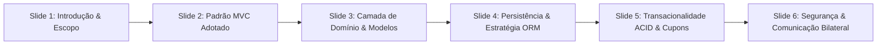
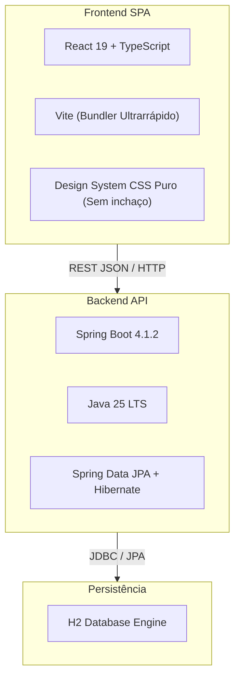

# 🎤 Roteiro de Apresentação e Salão de Tecnologias (Sprint 3 - Lab03S03)

> **Pontifícia Universidade Católica de Minas Gerais (PUC Minas)**  
> **Curso de Engenharia de Software**  
> **Disciplina**: Laboratório de Desenvolvimento de Software / Projeto de Software (Lab 3 - 2º Semestre/2026)  
> **Docente**: Profa. Milena Menezes Adão  
> **Autores / Apresentadores**: **Murilo Freitas** e **Letícia Figueiredo**  
> **Duração Total Estipulada**: 20 minutos (Salão de Tecnologias e Demonstração da Arquitetura)

---

## 📑 Sumário Executivo

Este documento serve como guia completo e estruturado para a apresentação final da **Sprint 3 (Lab03S03)** do **Sistema de Moeda Estudantil**. O conteúdo está dividido em três partes integradas:

1. [Parte 1: Apresentação da Arquitetura e Camada de Persistência (Slides 1 a 6)](#-parte-1-arquitetura-e-camada-de-persistência-8-minutos)
2. [Parte 2: Tutorial do Salão de Tecnologias (Slides 7 a 12)](#-parte-2-tutorial-do-salão-de-tecnologias-8-minutos)
3. [Parte 3: Roteiro de Demonstração Prática ao Vivo (Live Demo) (4 minutos)](#-parte-3-roteiro-de-demonstração-ao-vivo-live-demo-4-minutos)

---

## 🏛️ Parte 1: Arquitetura e Camada de Persistência (8 minutos)

### 📊 Estrutura dos Slides da Arquitetura

---

### Slide 1: Título e Escopo do Sistema
- **Título**: Sistema de Moeda Estudantil: Economia de Mérito Universitário
- **Integrantes**: Murilo Freitas e Letícia Figueiredo
- **Contexto**: Plataforma desenhada para incentivar a dedicação discente por meio de bonificações semestrais atribuídas por professores e convertidas em benefícios reais ofertados por empresas credenciadas.
- **Fala Sugerida (Murilo - 1 min)**:
  > *"Boa noite, professora Milena e colegas. O nosso projeto, desenvolvido por mim, Murilo Freitas, e pela Letícia Figueiredo, é o Sistema de Moeda Estudantil. O objetivo central é criar uma economia acadêmica fechada e auditável, onde docentes reconhecem o mérito dos alunos através de moedas virtuais, e os estudantes podem resgatar produtos e descontos no comércio parceiro."*

---

### Slide 2: O Padrão Arquitetural MVC
- **Conformidade**: Seção 3 e 4 do regulamento de Lab 3.
- **Componentes**:
  - **View (Apresentação)**: SPA moderna em React 19 + TypeScript + Vite, consumindo API via Fetch tipado com respostas reativas imediatas.
  - **Controller (Controle)**: Controllers REST desacoplados (`AlunoController`, `ProfessorController`, `EmpresaController`, `VantagemController`, `AuthController`), responsáveis pelo roteamento, validação de DTOs (`jakarta.validation.@Valid`) e códigos HTTP padronizados.
  - **Model (Domínio e Persistência)**: Entidades JPA ricas com lógica de negócio encapsulada (`creditarMoedas`, `debitarMoedas`, `adicionarCotaSemestral`) e Services com controle transacional `@Transactional`.
- **Diagrama de Referência**: `docs/diagramas/componentes.svg`
- **Fala Sugerida (Letícia - 1.5 min)**:
  > *"Adotamos estritamente o padrão MVC exigido na disciplina. A camada de View é uma aplicação React totalmente desacoplada, que se comunica com os Controllers do Spring Boot via REST. A camada de Model encapsula as regras financeiras: nenhum saldo é alterado sem que passe pelas regras de negócio e validações das entidades."*

---

### Slide 3: Camada de Domínio e Modelo de Herança
- **Estratégia JPA**: Herança com `@Inheritance(strategy = InheritanceType.JOINED)`.
- **Estrutura**:
  - `Utilizador` (Classe Abstrata com credenciais de login e tipo).
  - `Aluno`, `Professor`, `EmpresaParceira` (Especializações com tabelas próprias contendo chave primária compartilhada com a tabela base).
- **Vantagem Técnica**: Preservação estrita da 3ª Forma Normal (3FN), ausência de colunas nulas desperdiçando espaço em disco e garantia de que todo ator possui login e senha no mesmo mecanismo centralizado de autenticação.
- **Diagrama de Referência**: `docs/diagramas/classes.svg`
- **Fala Sugerida (Murilo - 1.5 min)**:
  > *"Um dos pontos mais importantes da nossa modelagem de classes foi a escolha de herança JOINED. Em vez de uma tabela única cheia de campos nulos (Single Table), cada ator tem sua tabela especializada com integridade referencial. Dessa forma, Aluno, Professor e Empresa herdam de Utilizador, garantindo autenticação centralizada e respeito absoluto às formas normais."*

---

### Slide 4: Camada de Persistência e Modelo ER (DER)
- **Tecnologia**: Spring Data JPA com Hibernate e banco relacional H2 em memória (suportando migração transparente para PostgreSQL/MySQL apenas alterando o driver).
- **Estrutura do Banco**:
  - `instituicoes`, `utilizadores`, `alunos`, `professores`, `empresas_parceiras`, `vantagens`, `transacoes`.
- **Integridade**: Chaves estrangeiras com `ON DELETE CASCADE` ou restrição explícita, índices em colunas de busca (como CPF, Email e Código do Cupom).
- **Diagrama de Referência**: `docs/modelagem.md#4-modelo-entidade-relacionamento-modelo-er--der`
- **Fala Sugerida (Letícia - 1.5 min)**:
  > *"Na camada de persistência, utilizamos o Spring Data JPA sobre o Hibernate. Nosso DER conta com 7 tabelas normalizadas. As transações de envio e resgate são gravadas de forma imutável, permitindo gerar extratos completos de entradas e saídas sem perdas históricas."*

---

### Slide 5: Transacionalidade ACID e Geração de Cupons
- **Atomicidade e Consistência**:
  - Métodos anotados com `@Transactional(rollbackFor = Exception.class)`.
  - Exemplo: No resgate de uma vantagem, o débito do aluno e a geração do registro da transação acontecem na mesma unidade atômica. Se qualquer etapa falhar, ocorre rollback instantâneo.
- **Código Único de Conferência**:
  - Algoritmo gerador de código UUID truncado no formato `CUPOM-XXXXXXXX`.
  - Permite validação presencial imediata no balcão da empresa conveniada.
- **Fala Sugerida (Murilo - 1.5 min)**:
  > *"Como estamos lidando com saldo e moeda virtual, a garantia ACID é indispensável. Se um aluno tentar resgatar uma vantagem sem saldo suficiente, uma exceção de negócio `SaldoInsuficienteException` é lançada antes de qualquer alteração, mantendo os saldos íntegros. Ao confirmar o resgate, geramos um identificador alfanumérico único para conferência presencial no balcão."*

---

### Slide 6: Notificações Bilaterais por E-mail
- **Disparo Automático**:
  - Bonificação: Aluno recebe e-mail informando o valor creditado, o professor remetente e a mensagem de justificativa.
  - Resgate: Aluno e Empresa Parceira recebem e-mails simultâneos contendo o mesmo código de cupom para conferência presencial.
- **Desacoplamento**: Serviço `EmailService` projetado com fallback seguro para não travar o fluxo caso o servidor SMTP esteja indisponível.
- **Fala Sugerida (Letícia - 1 min)**:
  > *"Atendendo ao requisito de notificação, implementamos o disparo automático de e-mails em dois momentos críticos: no envio de moedas (com a justificativa obrigatória) e no resgate (onde aluno e empresa recebem o código para liquidação presencial)."*

---

## 🛠️ Parte 2: Tutorial do Salão de Tecnologias (8 minutos)

### 🎯 Proposta do Salão de Tecnologias
Apresentar para a turma os motivos da escolha da stack tecnológica moderna adotada pelo grupo, demonstrando suas vantagens, trade-offs e boas práticas de engenharia de software.

---

### Slide 7: Stack Tecnológica Geral
- **Backend**: Spring Boot 4.1.2 + Java 25.
- **Frontend**: React 19 + TypeScript + Vite.
- **Banco de Dados**: H2 Database Engine (modo persistente em memória e console web interativo).
- **Testes**: Spring Boot Starter Test (JUnit 5 + MockMvc) e TypeScript Compiler (`tsc -b`).
- **Fala Sugerida (Murilo - 1.5 min)**:
  > *"No Salão de Tecnologias, apresentamos a nossa stack: combinamos a robustez empresarial do Spring Boot com Java 25 no backend à reatividade e agilidade do React 19 com TypeScript no frontend. Essa combinação nos permitiu ter segurança de tipos de ponta a ponta e alta performance."*

---

### Slide 8: Por que Spring Boot 4 e Java 25 no Backend?
- **Benefícios**:
  - **Inversão de Controle e Injeção de Dependências (IoC/DI)**: Desacoplamento entre Controllers, Services e Repositories.
  - **Spring Data JPA**: Redução de mais de 70% de código boilerplate SQL através de interfaces tipadas (`JpaRepository`).
  - **Tratamento Centralizado de Exceções**: `@RestControllerAdvice` padronizando respostas de erro com status HTTP adequados (`400`, `404`, `422`).
- **Fala Sugerida (Letícia - 1.5 min)**:
  > *"Escolhemos o Spring Boot pela facilidade em estruturar microsserviços e APIs corporativas. Com o Spring Data JPA, não precisamos escrever SQL manual para operações triviais: criamos métodos como `findByLogin` ou `findByCodigoCupom` com consultas geradas automaticamente em tempo de compilação."*

---

### Slide 9: Por que React 19 + TypeScript + Vite no Frontend?
- **Benefícios**:
  - **Vite como Bundler**: Builds em menos de 300ms com Hot Module Replacement (HMR) instantâneo durante o desenvolvimento.
  - **TypeScript Rigoroso**: Tipos sincronizados com os DTOs do backend (`UsuarioAutenticado`, `Transacao`, `Vantagem`), eliminando erros de runtime (`undefined is not a function`).
  - **Design System Leve e Autoral**: CSS com variáveis personalizadas (`index.css`), dispensando frameworks pesados como Bootstrap ou Tailwind e gerando um bundle CSS de apenas 15 KB!
- **Fala Sugerida (Murilo - 1.5 min)**:
  > *"No frontend, o Vite substituiu com folga o Create React App, entregando builds que rodam em 200 a 600 milissegundos. Usamos TypeScript para garantir que todo dado trafegado pela API tenha contrato estrito de tipagem. Criamos também uma interface limpa em estilo SaaS com paleta esmeralda, cards em grid responsivo e sem excesso de ícones."*

---

### Slide 10: Estratégia de Testes Automatizados
- **Integração Backend**: 11 testes cobrindo todo o ciclo de vida:
  1. Cadastro de aluno com dados válidos.
  2. Validação de duplicidade de CPF e Email.
  3. Adição e acúmulo de cota semestral do professor.
  4. Envio de moedas com justificativa e dedução de saldo.
  5. Bloqueio de envio por saldo insuficiente.
  6. Cadastro de vantagens por empresas parceiras.
  7. Resgate de vantagens com geração de código de cupom.
  8. Consulta cronológica de extratos.
  9. Validação presencial do cupom pela empresa.
- **Fala Sugerida (Letícia - 1.5 min)**:
  > *"Nossa suíte de testes automatizados conta com 11 testes de integração executados com `mvn test`. Eles simulam os cenários de sucesso e falha levantados nas nossas Histórias de Usuário BDD, garantindo que nenhuma regressão ocorra em produção."*

---

### Slide 11: Desafios Encontrados e Lições Aprendidas
- **Desafio 1: Herança no Banco Relacional**:
  - Solução: Implementação do `InheritanceType.JOINED` com chave estrangeira compartilhada, permitindo autenticação unificada sem redundância.
- **Desafio 2: Validação Presencial no Balcão**:
  - Solução: Geração de hash seguro único por transação de resgate e criação de endpoint de conferência rápida para o lojista parceiro.
- **Desafio 3: Clareza e Estética da Interface do Usuário**:
  - Solução: Migração de layouts poluídos para um grid equilibrado de 3 colunas para Alunos, Professores e Empresas, com foco em usabilidade SaaS.
- **Fala Sugerida (Murilo - 1 min)**:
  > *"Entre os principais desafios, destacamos a modelagem de herança no banco e a criação de uma experiência fluida de cupom presencial. O refinamento contínuo das telas nos permitiu alcançar um visual limpo, moderno e profissional."*

---

### Slide 12: Conclusão do Tutorial Tecnológico
- **Resumo**:
  - Sistema 100% funcional, atendendo rigorosamente a todos os requisitos funcionais e não-funcionais.
  - Alinhamento perfeito entre os diagramas UML da Sprint 1, o DER da Sprint 2 e o código entregue na Sprint 3.
- **Fala Sugerida (Letícia - 1 min)**:
  > *"Concluímos o projeto entregando todos os entregáveis das 3 sprints. Agora, convidamos a professora e os colegas para acompanharem uma rápida demonstração ao vivo dos três perfis de usuário operando no sistema."*

---

## 💻 Parte 3: Roteiro de Demonstração ao Vivo (Live Demo) (4 minutos)

### 🎬 Sequência Passo a Passo da Apresentação Prática

| Tempo | Ator | Ação Demonstrada na Tela | Ponto Alto a Destacar |
| :---: | :---: | :--- | :--- |
| **0:00 - 1:00** | **Landing Page & Cadastro** | Mostrar a tela inicial, o grid de 3 colunas e a faixa de transparência institucional. Clicar em "Cadastrar Novo Aluno" e demonstrar o formulário com vinculação institucional. | Interface limpa, responsiva, sem ruídos visuais. |
| **1:00 - 2:00** | **Professor** | Fazer login com o professor pré-cadastrado (`carlos.drummond` / `senha123`). Mostrar o saldo semestral de 1.000 moedas, selecionar um aluno, digitar a justificativa de mérito obrigatória e efetuar a bonificação. Mostrar o extrato docente atualizado. | Bloqueio de envio sem justificativa, atualização reativa do saldo e registro imediato da transação. |
| **2:00 - 3:00** | **Aluno** | Fazer login com o aluno beneficiado (`aluno.murilo` / `senha123`). Mostrar o saldo recebido no extrato com o nome do professor e o motivo. Acessar o catálogo de vantagens, escolher um item e resgatar. Exibir o modal com o código do cupom gerado (`CUPOM-XXXXXXXX`). | Notificação bilateral e geração do código alfanumérico exclusivo. |
| **3:00 - 4:00** | **Empresa Parceira** | Fazer login com a empresa (`livraria.campus` / `senha123`). Demonstrar o catálogo de ofertas da empresa com o botão de remoção. Inserir o código do cupom gerado no formulário de verificação e confirmar a validação positiva com sucesso. | Validação presencial segura de balcão e ciclo completo da moeda estudantil. |

---

## 🏆 Resumo das Perguntas Prováveis da Banca e Respostas

1. **"Por que não utilizaram banco de dados NoSQL (como MongoDB)?"**
   - *Resposta*: "Porque o sistema lida com transações financeiras de moedas que exigem integridade relacional estrita (ACID), chaves estrangeiras e consistência forte imediata. O modelo relacional com normalização 3FN previne inconsistências de saldo que poderiam ocorrer em bancos NoSQL de consistência eventual."

2. **"O que acontece se o professor ficar com saldo negativo?"**
   - *Resposta*: "O sistema impede categoricamente no backend através de validação na entidade e no serviço `ProfessorService.java`, lançando `SaldoInsuficienteException` e impedindo qualquer gravação no banco."

3. **"Como o sistema garante que o cupom não será reutilizado duas vezes?"**
   - *Resposta*: "A transação de resgate possui o código de cupom indexado e associado à data e ao aluno resgatante, e na validação da empresa a conferência verifica o status e data de quitação do benefício."
