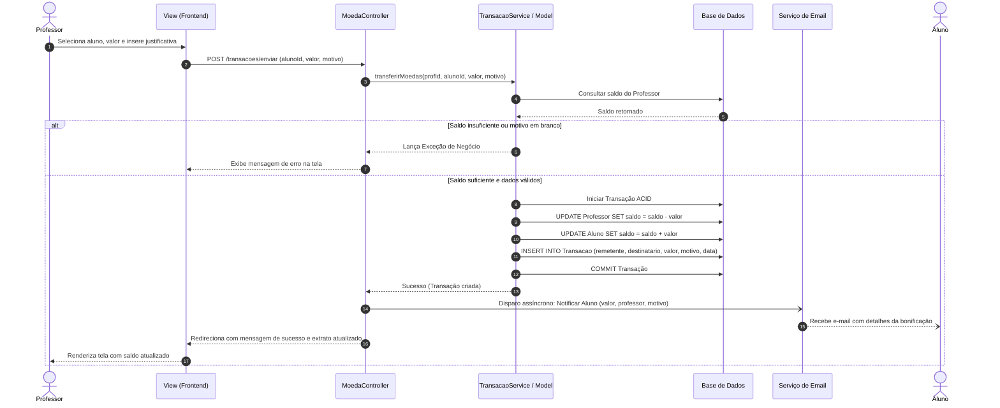
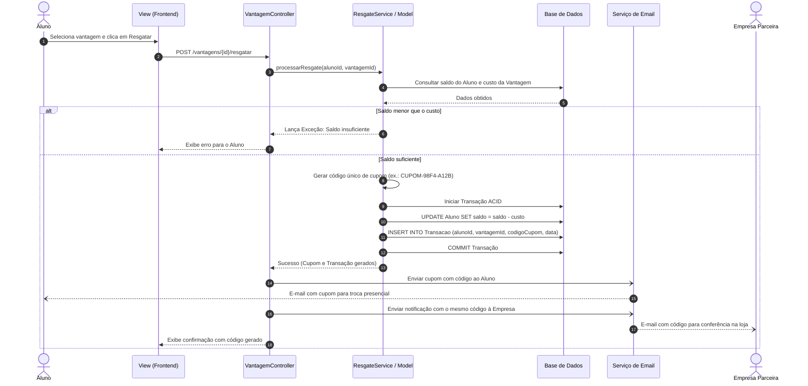

# 🏛️ Arquitetura do Sistema e Decisões de Design

Este documento documenta as decisões arquiteturais adotadas no **Sistema de Moeda Estudantil**, detalhando o padrão **MVC (Model-View-Controller)**, os fluxos de dados, a camada de persistência e a integração com serviços externos (envio de e-mails).

---

## 1. Padrão Arquitetural MVC

Conforme estabelecido pela especificação do projeto (seção 3 e 4 do documento acadêmico), o sistema adota estritamente o padrão **MVC (Model-View-Controller)**, assegurando separação clara de responsabilidades, desacoplamento e manutenibilidade.

### 1.1 Camada View (Apresentação)
- Responsável por renderizar a interface de usuário (HTML5, CSS3, JavaScript responsivo).
- Não contém regras de negócio ou lógica de acesso ao banco de dados.
- Captura interações (cliques, preenchimento de formulários) e despacha requisições para os controladores correspondentes.
- Telas principais:
  - Tela de Login e Seleção de Perfil.
  - Tela de Cadastro de Aluno (com seleção de Instituição de Ensino pré-cadastrada).
  - Tela de Cadastro de Empresa Parceira.
  - Painel do Professor (Saldo semestral, formulário de envio de moedas com justificativa obrigatória e extrato).
  - Painel do Aluno (Saldo acumulado, extrato de entradas e saídas, catálogo de vantagens disponíveis para resgate).
  - Painel da Empresa Parceira (Cadastro de novas vantagens com foto, descrição e custo, e validação de cupons).

### 1.2 Camada Controller (Controle)
- Ponto de entrada de requisições vindas da interface (rotas e handlers).
- Responsável por validar parâmetros de entrada, gerenciar sessões e autenticação.
- Coordena a chamada aos serviços da camada de domínio (`Model`).
- Aciona o serviço de e-mail ao término de transações que exigem notificações ou cupons de resgate.
- Seleciona e redireciona para a View apropriada com os dados a serem exibidos.

### 1.3 Camada Model (Negócio e Persistência)
- Contém as entidades de negócio (`Utilizador`, `Aluno`, `Professor`, `EmpresaParceira`, `Instituicao`, `Vantagem`, `Transacao`).
- Implementa as regras de negócio invariantes (ex.: validação de saldo antes do débito, garantia de justificativa não-vazia, acúmulo de saldo semestral).
- Implementa a persistência de dados utilizando ORM ou o padrão DAO (Data Access Object), conforme planejado para a Sprint 2.

---

## 2. Fluxos Principais do Sistema

### 2.1 Fluxo de Envio de Moedas (Professor -> Aluno)

Abaixo, o diagrama de sequência detalha o fluxo completo de bonificação:

---

### 2.2 Fluxo de Resgate de Vantagem (Aluno -> Empresa Parceira)

Abaixo, o fluxo de resgate com débito de saldo, emissão e conferência de cupom:

---

## 3. Integração com Serviços Externos

### 3.1 Serviço de E-mail
O sistema possui acoplamento fraco com o envio de mensagens, podendo utilizar:
- Protocolo SMTP padrão (ex.: Gmail, SendGrid, Mailgun ou servidor institucional da PUC Minas).
- Mock/Ambiente de testes (ex.: Mailtrap, FakeSMTP ou logs locais em ambiente de desenvolvimento).

### 3.2 Camada de Persistência (Planejamento Sprint 2)
- Sistema Gerenciador de Banco de Dados Relacional (PostgreSQL / MySQL / SQLite).
- Estrutura projetada para garantir idempotência em operações financeiras e concorrência segura em transações de saldo.
