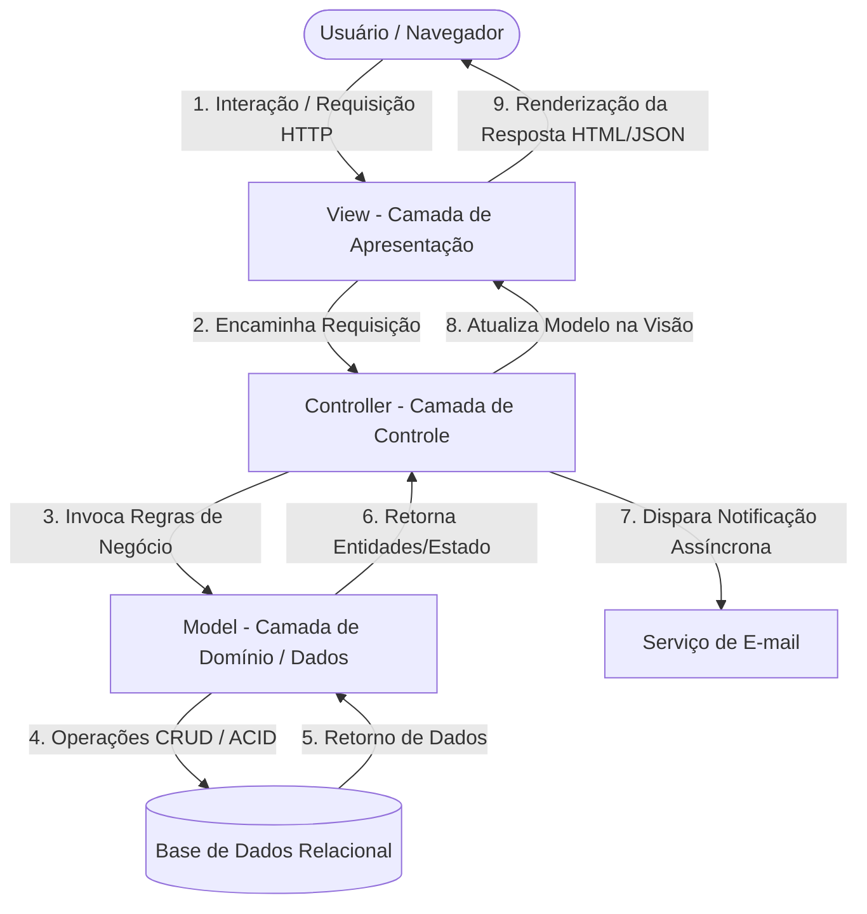
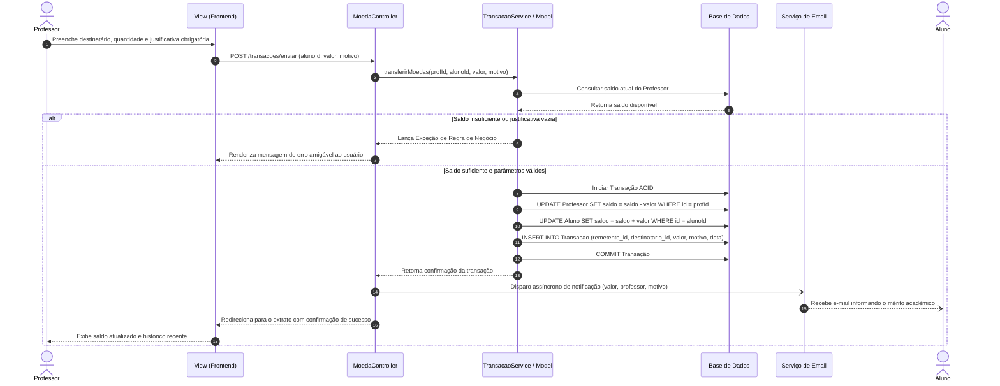
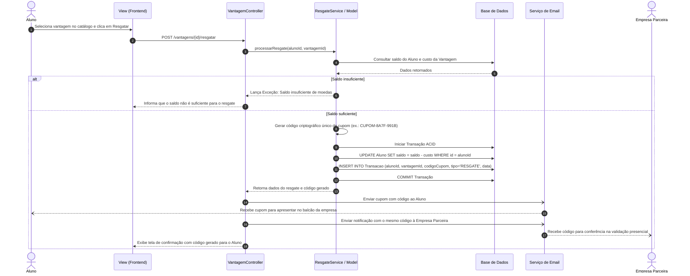

# 🏛️ Arquitetura do Sistema e Decisões de Design

> **Pontifícia Universidade Católica de Minas Gerais (PUC Minas)**  
> **Curso de Engenharia de Software**  
> **Disciplina**: Laboratório de Desenvolvimento de Software / Projeto de Software (Lab 3 - 2º Semestre/2026)  
> **Docente**: Profa. Milena Menezes Adão  
> **Autores / Desenvolvedores**: **Murilo Freitas** e **Letícia Figueiredo**  

---

## 📑 Sumário

1. [Visão Geral da Arquitetura MVC](#1-visão-geral-da-arquitetura-mvc)
2. [Justificativas das Escolhas Arquiteturais (Macro e Micro)](#2-justificativas-das-escolhas-arquiteturais)
   - [2.1 Escolhas Macro-Arquiteturais (Sistema e Estrutura)](#21-escolhas-macro-arquiteturais-nível-de-sistema)
   - [2.2 Escolhas Micro-Arquiteturais (Design de Classes e Código)](#22-escolhas-micro-arquiteturais-nível-de-código-e-domínio)
3. [Fluxos Principais e Diagramas de Sequência](#3-fluxos-principais-e-diagramas-de-sequência)
   - [3.1 Envio de Moedas (Professor -> Aluno)](#31-fluxo-de-envio-de-moedas-professor---aluno)
   - [3.2 Resgate de Vantagens (Aluno -> Empresa Parceira)](#32-fluxo-de-resgate-de-vantagem-aluno---empresa-parceira)
4. [Integração com Serviços Externos e Persistência](#4-integração-com-serviços-externos-e-persistência)

---

## 1. Visão Geral da Arquitetura MVC

Conforme estabelecido pela especificação do projeto (seção 3 e 4 do documento acadêmico), o sistema adota estritamente o padrão arquitetural **MVC (Model-View-Controller)**, dividindo o software em três camadas de responsabilidade bem delineadas.

### 1.1 Camada View (Apresentação)
- Responsável pela renderização da interface com o usuário (HTML5 semântico, CSS3 e JavaScript).
- Desprovida de regras de negócio ou instruções SQL/persistência.
- Captura eventos do usuário e emite requisições para os controladores.
- Principais telas:
  - Autenticação e seleção de perfil (Aluno, Professor, Empresa Parceira).
  - Formulário de cadastro de Aluno (com seleção de Instituição de Ensino pré-cadastrada).
  - Formulário de cadastro de Empresa Parceira.
  - Painel do Professor (visualização de cota semestral, formulário de bonificação com mensagem obrigatória e extrato).
  - Painel do Aluno (saldo corrente, extrato de entradas/saídas e catálogo de vantagens disponíveis para resgate).
  - Painel da Empresa Parceira (cadastro de vantagens com foto, descrição e custo, e validação de cupons).

### 1.2 Camada Controller (Controle)
- Recebe requisições HTTP oriundas das Views (endpoints/rotas).
- Valida tokens de sessão, autenticação e parâmetros de entrada.
- Delega a execução das operações para os serviços e entidades do `Model`.
- Dispara eventos de notificação e envio de e-mails após o commit das transações.
- Retorna o resultado para a View correspondente (redirecionamento ou payload de dados).

### 1.3 Camada Model (Domínio e Persistência)
- Encapsula as regras de negócio invariantes (`Utilizador`, `Aluno`, `Professor`, `EmpresaParceira`, `Instituicao`, `Vantagem`, `Transacao`).
- Implementa validações estritas (ex.: saldo suficiente, justificativa não vazia, acúmulo de cotas).
- Responsável pela comunicação com a base de dados via ORM ou Padrão DAO (conforme Sprint 2).

---

## 2. Justificativas das Escolhas Arquiteturais

Com o objetivo de fundamentar as decisões técnicas tomadas pela equipe de desenvolvimento (**Murilo Freitas** e **Letícia Figueiredo**), discriminamos abaixo o **porquê** de cada escolha, segmentada entre **Macro-Arquitetura** (decisões estruturais do sistema) e **Micro-Arquitetura** (decisões de classes, padrões e regras no código).

---

### 2.1 Escolhas Macro-Arquiteturais (Nível de Sistema)

| Decisão Macro | O que é? | Por que foi escolhida? (Justificativa Técnica) | Alternativas Descartadas e Risco Mitigado |
| :--- | :--- | :--- | :--- |
| **Adoção do Padrão MVC** | Separação do sistema em Camadas de Apresentação (View), Controle (Controller) e Domínio (Model). | **1. Requisito Formal**: Exigido na especificação oficial da disciplina. **2. Separação de Preocupações (SoC)**: Permite que a lógica de negócio permaneça 100% isolada da interface gráfica. **3. Desenvolvimento Paralelo**: Permite que membros da equipe trabalhem simultaneamente nas interfaces e nos serviços de backend sem conflito de código. | *Arquitetura Monolítica sem camadas*: Descartada por gerar alto acoplamento ("código espaguete"), tornando a manutenção e os testes extremamente custosos. |
| **Banco de Dados Relacional com Transações ACID** | Persistência baseada em tabelas com chaves primárias, estrangeiras e transações atômicas. | **1. Natureza Financeira**: O sistema opera uma economia de moedas virtuais. É imperativo garantir atomicidade: o débito no professor/aluno e o crédito/resgate devem ocorrer na mesma transação atômica. **2. Prevenção de Gasto Duplo (*Double-Spending*)**: Evita que requisições concorrentes utilizem as mesmas moedas simultaneamente através de *locks* ou controle transacional. **3. Integridade Referencial Estrita**: Garante que nenhuma transação exista sem aluno ou professor válido, nem vantagens sem empresa vinculada. | *Bancos NoSQL baseados em consistência eventual*: Descartados devido ao risco de inconsistência em saldos financeiros sob concorrência e ausência nativa de integridade relacional forte. |
| **Serviço de E-mail Desacoplado e Assíncrono** | Módulo de envio de e-mails apartado da thread principal de requisição HTTP. | **1. Desempenho e Latência**: Conexões SMTP externas introduzem latências de centenas de milissegundos ou segundos. Desacoplar o envio evita travamento da interface do usuário. **2. Resiliência e Tolerância a Falhas**: Se o servidor SMTP estiver temporariamente instável, a transação financeira no banco de dados já foi concretizada com sucesso e o envio do e-mail pode sofrer novas tentativas (*retry*) em segundo plano sem abortar a operação de negócio. | *Envio Síncrono Inline*: Descartado por degradar o tempo de resposta da aplicação e provocar falhas falsas em transações bem-sucedidas. |
| **Estratégia de Persistência desacoplada (DAO/ORM)** | Camada intermediária de acesso a dados que abstrai o SQL e a conexão direta com o SGBD. | **1. Portabilidade**: Facilita a troca ou migração do motor de banco de dados (ex.: SQLite em testes locais, PostgreSQL em produção). **2. Testabilidade**: Viabiliza testes unitários nas regras de negócio utilizando Mocks ou bases em memória sem depender do banco de dados físico estar ativo. | *Instruções SQL espalhadas nos Controladores*: Descartado por violar categoricamente as boas práticas de engenharia de software e segurança (risco de SQL Injection). |

---

### 2.2 Escolhas Micro-Arquiteturais (Nível de Código e Domínio)

| Decisão Micro | O que é? | Por que foi escolhida? (Justificativa Técnica) |
| :--- | :--- | :--- |
| **Classe Abstrata `Utilizador` com Herança** | Generalização que concentra `login`, `senha` e o método `autenticar()`, herdada por `Aluno`, `Professor` e `EmpresaParceira`. | **1. Reúso de Lógica de Autenticação**: Elimina a duplicação de atributos e rotinas de validação de credenciais. **2. Polimorfismo e Segurança**: Permite que o interceptor/filtro de autenticação processe instâncias de `Utilizador` de forma transparente, identificando posteriormente o perfil específico (RBAC - Role-Based Access Control). **3. Extensibilidade**: Caso surja um novo perfil (ex.: `Administrador`), basta herdar de `Utilizador` sem alterar as regras de login existentes. |
| **Especialização de Entidades (`Aluno`, `Professor`, `EmpresaParceira`)** | Classes de domínio dedicadas para cada ator em vez de uma tabela única genérica de usuários. | **1. Alta Coesão e Responsabilidade Única (SRP)**: Cada ator possui atributos e comportamentos substancialmente distintos (ex.: Professor possui `departamento` e `saldo = 1000` semestral; Aluno possui `curso`, `endereco`, `cpf`, `rg` e `saldo` de mérito; Empresa possui catálogo de `Vantagem`). **2. Eliminação de Campos Nulos**: Uma entidade única concentradora resultaria em dezenas de colunas nulas no banco de dados e verificações constantes de `if (tipo == PROFESSOR)`. |
| **Entidade de Domínio Imutável `Transacao`** | Classe dedicada para registrar cada operação de transferência de moedas ou resgate. | **1. Auditoria e Rastreabilidade (RN08)**: Não é suficiente incrementar ou decrementar saldos; é necessário comprovar historicamente a origem, destino, data e valor. **2. Obrigatoriedade da Justificativa**: A entidade `Transacao` formaliza o vínculo do motivo obrigatório que o professor deve redigir ao reconhecer um aluno. **3. Não-Repúdio e Imutabilidade**: Uma vez persistido, o registro da transação jamais deve ser alterado ou excluído, assegurando integridade histórica para o extrato. |
| **Geração Bilateral de Código Único de Cupom** | Código alfanumérico único gerado no ato do resgate e disparado via e-mail para o Aluno e para a Empresa Parceira. | **1. Segurança na Troca Presencial**: O resgate ocorre digitalmente, mas a retirada física é presencial. O código partilhado via canal seguro (e-mail) previne que alunos falsifiquem cupons ou que empresas parceiras neguem o recebimento do benefício. **2. Privacidade de Dados**: A empresa parceira necessita apenas conferir o código para liberar o desconto/produto, sem necessidade de acessar dados pessoais sensíveis do aluno (como RG, CPF ou endereço). |
| **Encapsulamento Estrito e Modelo Rico (*Tell, Don't Ask*)** | Atributos privados com métodos negociais dentro dos Models (`enviarMoedas`, `resgatarVantagem`) em vez de simples *getters* e *setters*. | **1. Prevenção do Antipadrão Modelo Anêmico**: As regras de validação (ex.: verificar se o saldo é suficiente antes de subtrair, validar se o valor é positivo) residem no próprio domínio. **2. Integridade de Estado**: O saldo de um aluno ou professor nunca pode ser manipulado arbitrariamente de fora da entidade, evitando estados inconsistentes no ciclo de vida do objeto. |

---

## 3. Fluxos Principais e Diagramas de Sequência

### 3.1 Fluxo de Envio de Moedas (Professor -> Aluno)

O envio de moedas reflete a aplicação estrita das regras de negócio **RN03**, **RN04**, **RN05** e **RN08**, com controle transacional e notificação por e-mail:

---

### 3.2 Fluxo de Resgate de Vantagem (Aluno -> Empresa Parceira)

O resgate de vantagens implementa as regras **RN06**, **RN07** e **RN08**, garantindo a emissão do código único e a notificação simultânea para conferência presencial:

---

## 4. Integração com Serviços Externos e Persistência

### 4.1 Serviço de E-mail
- **Papel**: Notificação imediata ao aluno ao receber moedas e envio simultâneo de cupons criptografados ao aluno e à empresa parceira.
- **Implementação**: Desacoplada via interface `EmailService`, permitindo alternância transparente entre:
  - Servidor SMTP em produção (SendGrid, Mailgun ou SMTP institucional PUC Minas).
  - Emuladores e Mocks de desenvolvimento (Mailtrap, FakeSMTP ou logs locais de console).

### 4.2 Camada de Persistência (Planejamento Sprint 2)
- **Tecnologia**: SGBD Relacional (PostgreSQL, MySQL ou SQLite).
- **Integridade**: Suporte nativo a Foreign Keys, restrições `CHECK (saldo >= 0)` e isolamento transacional para evitar concorrência descontrolada (*race conditions*).
