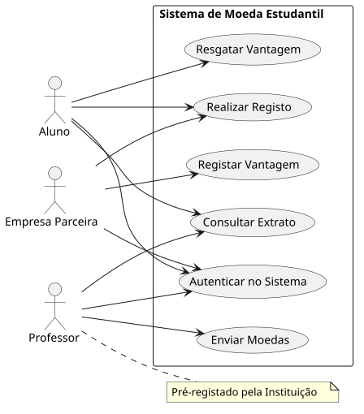
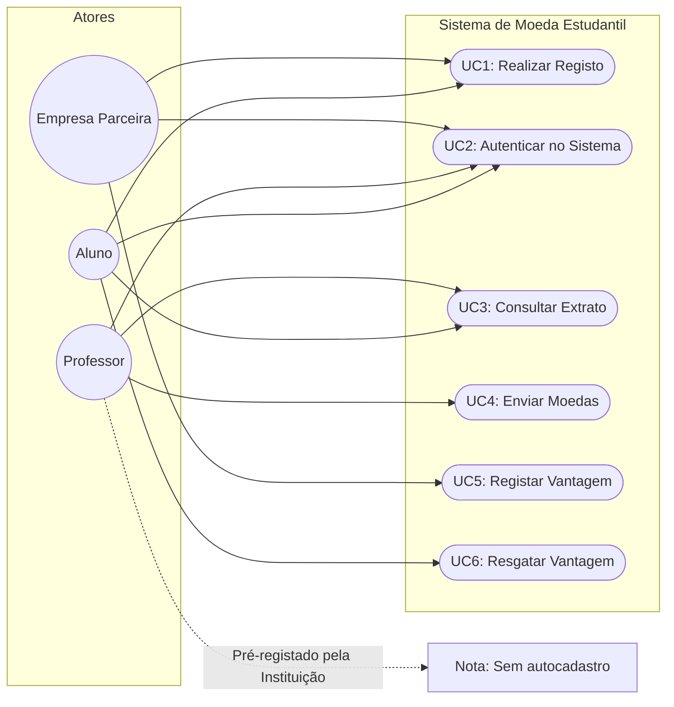
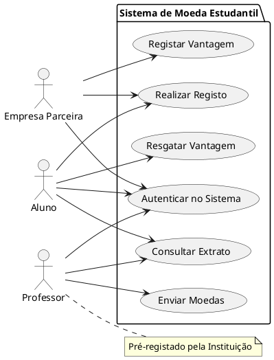
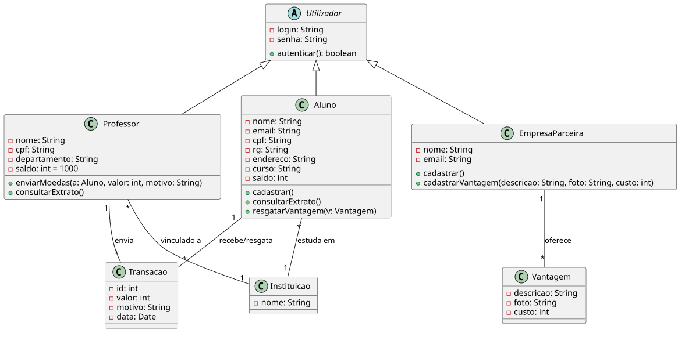
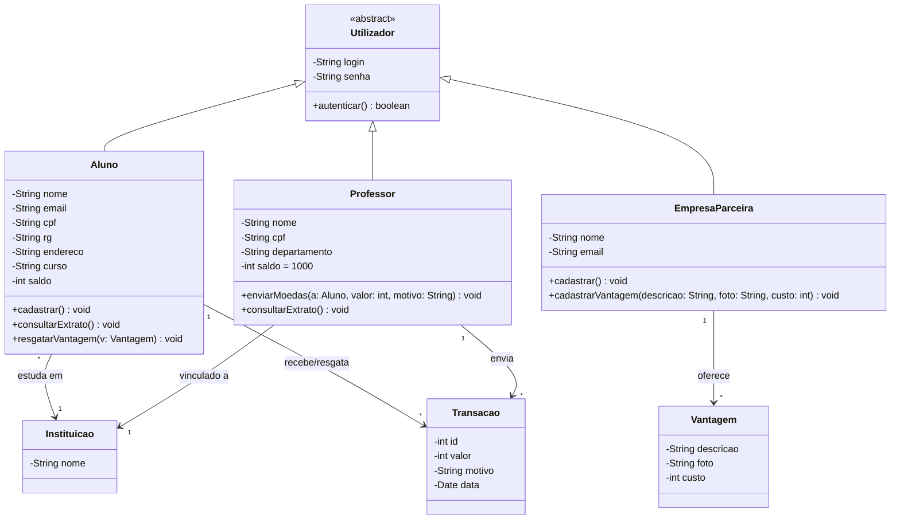
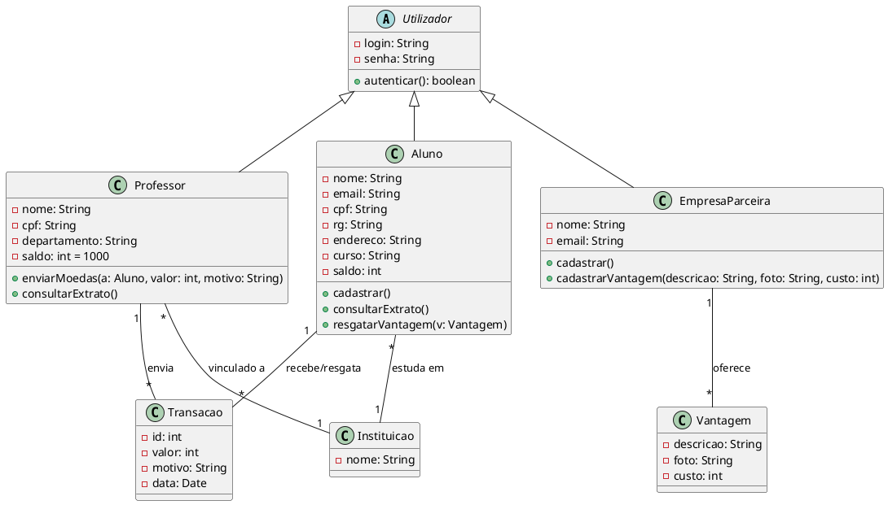
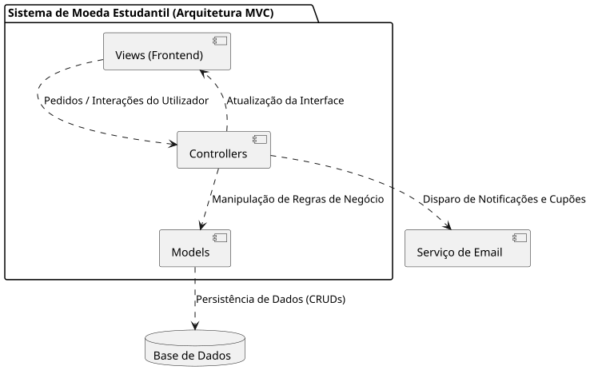
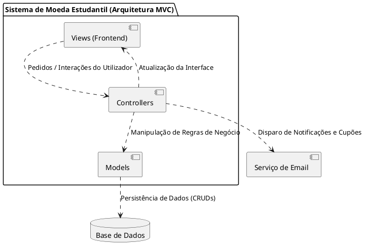

# 📐 Modelagem do Sistema (Sprint 1 - Lab03S01)

> **Pontifícia Universidade Católica de Minas Gerais (PUC Minas)**  
> **Curso de Engenharia de Software**  
> **Disciplina**: Laboratório de Desenvolvimento de Software / Projeto de Software (Lab 3 - 2º Semestre/2026)  
> **Docente**: Profa. Milena Menezes Adão  
> **Autores / Integrantes**: **Murilo Freitas** e **Letícia Figueiredo**  

Este documento consolida os artefatos de modelagem de software produzidos na **Sprint 1 (Lab03S01)** para o **Sistema de Moeda Estudantil**, de acordo com as especificações da disciplina de **Laboratório de Desenvolvimento de Software / Projeto de Software** (PUC Minas).

---

## 📑 Sumário da Modelagem

1. [Diagrama de Casos de Uso](#1-diagrama-de-casos-de-uso)
   - [Visualização Gráfica](#visualização-gráfica-casos-de-uso)
   - [Diagrama Interativo (Mermaid)](#diagrama-interativo-mermaid-casos-de-uso)
   - [Detalhamento dos Casos de Uso (UC1 a UC6)](#detalhamento-dos-casos-de-uso)
   - [Código PlantUML](#código-plantuml-casos-de-uso)
2. [Diagrama de Classes](#2-diagrama-de-classes)
   - [Visualização Gráfica](#visualização-gráfica-classes)
   - [Diagrama Interativo (Mermaid)](#diagrama-interativo-mermaid-classes)
   - [Dicionário de Classes e Atributos](#dicionário-de-classes-e-atributos)
   - [Relacionamentos e Multiplicidades](#relacionamentos-e-multiplicidades)
   - [Código PlantUML](#código-plantuml-classes)
3. [Diagrama de Componentes](#3-diagrama-de-componentes)
   - [Visualização Gráfica](#visualização-gráfica-componentes)
   - [Diagrama Interativo (Mermaid)](#diagrama-interativo-mermaid-componentes)
   - [Detalhamento dos Componentes e Camadas MVC](#detalhamento-dos-componentes-e-camadas-mvc)
   - [Código PlantUML](#código-plantuml-componentes)

---

## 1. Diagrama de Casos de Uso

O Diagrama de Casos de Uso modela o comportamento dinâmico do sistema a partir do ponto de vista dos atores externos (**Aluno**, **Professor** e **Empresa Parceira**), mapeando suas fronteiras e interações com as funcionalidades do Sistema de Moeda Estudantil.

### Visualização Gráfica (Casos de Uso)



### Diagrama Interativo (Mermaid - Casos de Uso)



### Detalhamento dos Casos de Uso

| Caso de Uso | Atores | Descrição | Pré-condição | Pós-condição |
| :--- | :--- | :--- | :--- | :--- |
| **UC1 - Realizar Registo** | Aluno, Empresa Parceira | Permite o cadastro inicial no sistema informando dados pessoais/empresariais e credenciais de acesso. | O usuário não deve possuir conta cadastrada. | Conta criada no banco de dados com credenciais ativas. |
| **UC2 - Autenticar no Sistema** | Aluno, Professor, Empresa Parceira | Valida as credenciais de acesso (login e senha) e inicia a sessão segura do usuário no sistema. | Possuir cadastro prévio (ou pré-registro no caso do Professor). | Sessão autenticada iniciada com permissões associadas ao perfil. |
| **UC3 - Consultar Extrato** | Aluno, Professor | Permite a visualização do saldo atual e da listagem de transações financeiras realizadas na conta. | Usuário autenticado como Aluno ou Professor. | Informações financeiras e histórico de transações renderizados em tela. |
| **UC4 - Enviar Moedas** | Professor | Permite ao docente transferir moedas da sua cota semestral para um aluno, com justificativa obrigatória. | Professor autenticado com saldo suficiente de moedas. | Saldo do professor debitado, saldo do aluno creditado, transação salva e e-mail enviado ao aluno. |
| **UC5 - Registar Vantagem** | Empresa Parceira | Permite à empresa cadastrar um produto ou serviço com descrição, imagem/foto e custo em moedas. | Empresa parceira autenticada. | Vantagem disponível no catálogo para resgate pelos alunos. |
| **UC6 - Resgatar Vantagem** | Aluno | Permite ao discente trocar moedas acumuladas por uma vantagem ofertada por empresa parceira. | Aluno autenticado com saldo suficiente para cobrir o custo da vantagem. | Saldo do aluno debitado, cupom com código único gerado e disparado por e-mail para aluno e parceiro. |

> **Nota Importante**: O ator **Professor** não realiza autocadastro via UC1. O corpo docente é pré-cadastrado no sistema diretamente pela Instituição de Ensino parceira, recebendo suas credenciais de acesso inicial.

### Código PlantUML (Casos de Uso)



---

## 2. Diagrama de Classes

O Diagrama de Classes expressa a estrutura estática do domínio do Sistema de Moeda Estudantil, organizando as entidades de negócio, seus atributos privados, métodos públicos e os relacionamentos de herança e associação.

### Visualização Gráfica (Classes)



### Diagrama Interativo (Mermaid - Classes)



### Dicionário de Classes e Atributos

#### 1. `Utilizador` (Classe Abstrata)
Representa a generalização de qualquer entidade autenticável no sistema.
- **Atributos**:
  - `- login: String`: Identificador único de acesso (ex.: email ou identificador alfanumérico).
  - `- senha: String`: Senha armazenada de forma segura (hash criptográfico).
- **Métodos**:
  - `+ autenticar(): boolean`: Valida login e senha informados contra a base de dados.

#### 2. `Aluno` (Herda de `Utilizador`)
Representa o discente matriculado que recebe bonificações e realiza resgates.
- **Atributos**:
  - `- nome: String`: Nome completo do discente.
  - `- email: String`: Endereço de correio eletrônico para notificações e cupons.
  - `- cpf: String`: Cadastro de Pessoa Física (identificador único governamental).
  - `- rg: String`: Registro Geral.
  - `- endereco: String`: Endereço residencial do discente.
  - `- curso: String`: Curso de graduação ou pós-graduação no qual está matriculado.
  - `- saldo: int`: Montante disponível de moedas estudantis acumuladas.
- **Métodos**:
  - `+ cadastrar()`: Registra um novo aluno no sistema vinculado a uma instituição.
  - `+ consultarExtrato()`: Recupera e exibe saldo e histórico de transações.
  - `+ resgatarVantagem(v: Vantagem)`: Valida saldo, debita custo e emite cupom de resgate.

#### 3. `Professor` (Herda de `Utilizador`)
Representa o docente responsável por bonificar os alunos com moedas.
- **Atributos**:
  - `- nome: String`: Nome completo do professor.
  - `- cpf: String`: Cadastro de Pessoa Física.
  - `- departamento: String`: Departamento acadêmico de atuação.
  - `- saldo: int = 1000`: Saldo disponível para distribuição no semestre (iniciado com 1.000 moedas e cumulativo).
- **Métodos**:
  - `+ enviarMoedas(a: Aluno, valor: int, motivo: String)`: Transfere moedas para o aluno especificado com justificativa formal obrigatória.
  - `+ consultarExtrato()`: Recupera histórico de moedas distribuídas pelo professor.

#### 4. `EmpresaParceira` (Herda de `Utilizador`)
Representa a organização conveniada que disponibiliza produtos e descontos.
- **Atributos**:
  - `- nome: String`: Razão social ou nome fantasia da empresa parceira.
  - `- email: String`: E-mail corporativo para recebimento de cupons de conferência.
- **Métodos**:
  - `+ cadastrar()`: Cria a conta da empresa parceira no sistema.
  - `+ cadastrarVantagem(descricao: String, foto: String, custo: int)`: Insere uma nova vantagem no catálogo de resgates.

#### 5. `Instituicao`
Representa a entidade de ensino participante que mantém cursos e docentes.
- **Atributos**:
  - `- nome: String`: Nome oficial da Instituição de Ensino Superior parceira.

#### 6. `Vantagem`
Representa um item resgatável pelos alunos oferecido por uma empresa parceira.
- **Atributos**:
  - `- descricao: String`: Detalhes do produto, serviço ou desconto oferecido.
  - `- foto: String`: URI/caminho ou identificador da imagem ilustrativa da vantagem.
  - `- custo: int`: Valor em moedas necessário para efetuar o resgate.

#### 7. `Transacao`
Representa o registro financeiro e de auditoria de qualquer movimentação de moedas.
- **Atributos**:
  - `- id: int`: Identificador unívoco da transação.
  - `- valor: int`: Quantidade de moedas movimentadas.
  - `- motivo: String`: Justificativa do professor ou descrição do resgate efetuado.
  - `- data: Date`: Carimbo de data e hora em que a movimentação ocorreu.

### Relacionamentos e Multiplicidades

- **Generalização/Herança**: `Aluno`, `Professor` e `EmpresaParceira` especializam `Utilizador` (`Utilizador <|-- Aluno`, `Utilizador <|-- Professor`, `Utilizador <|-- EmpresaParceira`).
- **`Aluno` - `Instituicao`**: Muitos alunos (`*`) pertencem a exatamente uma (`1`) instituição (`estuda em`).
- **`Professor` - `Instituicao`**: Muitos professores (`*`) estão vinculados a exatamente uma (`1`) instituição (`vinculado a`).
- **`EmpresaParceira` - `Vantagem`**: Uma (`1`) empresa parceira pode oferecer várias (`*`) vantagens (`oferece`).
- **`Aluno` - `Transacao`**: Um (`1`) aluno pode receber moedas ou resgatar vantagens através de múltiplas (`*`) transações (`recebe/resgata`).
- **`Professor` - `Transacao`**: Um (`1`) professor pode realizar múltiplos (`*`) envios de moedas registrados como transações (`envia`).

### Código PlantUML (Classes)



---

## 3. Diagrama de Componentes

O Diagrama de Componentes descreve a organização em módulos do software e a sua integração estrutural em camadas segundo a arquitetura **MVC (Model-View-Controller)**, bem como a comunicação com serviços e sistemas externos (**Base de Dados** e **Serviço de Email**).

### Visualização Gráfica (Componentes)



### Diagrama Interativo (Mermaid - Componentes)

```mermaid
flowchart TB
    subgraph MVC["Sistema de Moeda Estudantil (Arquitetura MVC)"]
        Views["[Views (Frontend)]<br>Interfaces Web / Telas"]
        Controllers["[Controllers]<br>Controladores e Regras de Negócio"]
        Models["[Models]<br>Modelos de Domínio e Entidades"]
    end

    BD[("Base de Dados<br>Persistência Relacional")]
    Email["[Serviço de Email]<br>Notificações e Cupons"]

    Views -->|Pedidos / Interações do Utilizador| Controllers
    Controllers -->|Manipulação de Regras de Negócio| Models
    Controllers -->|Atualização da Interface| Views
    Models -->|Persistência de Dados (CRUDs)| BD
    Controllers -->|Disparo de Notificações e Cupões| Email
```

### Detalhamento dos Componentes e Camadas MVC

| Componente | Camada | Papel e Responsabilidades | Dependências e Conexões |
| :--- | :---: | :--- | :--- |
| **Views (Frontend)** | Apresentação | Apresenta a interface gráfica ao usuário (telas de login, extrato, catálogo de vantagens, formulários de envio e cadastro). Captura eventos e envia requisições HTTP para os controladores. | Envia pedidos para `Controllers`; é renderizada e atualizada a partir dos dados do `Controllers`. |
| **Controllers** | Controle | Recebe e processa requisições vindas das Views; orquestra as regras de negócio chamando os métodos do domínio (`Models`); aciona o `Serviço de Email` para notificações e gera os códigos de conferência. | Interage com `Views`, coordena `Models`, dispara requisições para o `Serviço de Email`. |
| **Models** | Negócio e Domínio | Encapsula as regras de negócio, dados de domínio (`Aluno`, `Professor`, `EmpresaParceira`, `Vantagem`, `Transacao`) e lógica de persistência e validações. | Acessado por `Controllers`; comunica-se com a `Base de Dados` para operações CRUD e transações financeiras. |
| **Base de Dados** | Infraestrutura | Sistema Gerenciador de Banco de Dados Relacional responsável por garantir persistência durável, integridade referencial e transacionalidade (ACID) das operações financeiras. | Recebe comandos e queries executadas pela camada de `Models` (via ORM ou DAO). |
| **Serviço de Email** | Serviço Externo | Provedor de envio de correio eletrônico responsável pelo envio de mensagens de confirmação de cadastro, notificação de bonificação e envio de cupons de resgate aos alunos e parceiros. | Acionado pelos `Controllers` após a confirmação das transações de negócio. |

### Código PlantUML (Componentes)


