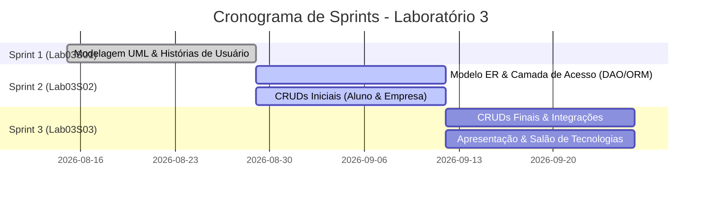

# 🚀 Planejamento e Acompanhamento das Sprints

Este documento detalha o planejamento, cronograma e acompanhamento das três Sprints de desenvolvimento do **Sistema de Moeda Estudantil**, em conformidade com as diretrizes do **Laboratório 3 de Projeto de Software** (PUC Minas - Segundo Semestre/2026 - Profa. Milena Menezes Adão).

---

## 📅 Visão Geral do Ciclo de Desenvolvimento

---

## 1. Sprint 1 - Lab03S01: Modelagem do Sistema

### 🎯 Objetivo
Elaborar a fundamentação conceitual, requisitos e artefatos de modelagem de software para o Sistema de Moeda Estudantil, cobrindo todas as necessidades dos atores mapeados.

### 📦 Entregáveis da Sprint 1
- [x] **Diagrama de Casos de Uso** (PlantUML, SVG e especificação textual com UC1 a UC6).
- [x] **Histórias de Usuário (User Stories)** (HU01 a HU06 completas, com critérios de aceitação BDD / Gherkin).
- [x] **Diagrama de Classes** (PlantUML, SVG, Mermaid e dicionário detalhado de entidades, atributos e métodos).
- [x] **Diagrama de Componentes** (PlantUML, SVG e detalhamento da arquitetura MVC e integrações com Banco de Dados e E-mail).
- [x] **Repositório GitHub** estruturado com `README.md` principal e pasta `docs/`.

---

## 2. Sprint 2 - Lab03S02: Persistência e CRUDs Iniciais

### 🎯 Objetivo
Definir o modelo de dados relacional (Modelo ER), estruturar a camada de acesso a dados (ORM ou padrão DAO) e desenvolver a versão inicial funcional dos CRUDs centrais do sistema com comunicação front-end e back-end.

### 📦 Entregáveis da Sprint 2
- [ ] **Modelo Entidade-Relacionamento (Modelo ER / DER)**: Mapeamento de tabelas, chaves primárias/estrangeiras e restrições de integridade.
- [ ] **Estratégia de Acesso a Dados**: Definição e implementação (ex.: Hibernate/JPA, Prisma, TypeORM, SQLAlchemy ou Padrão DAO nativo).
- [ ] **CRUD de Aluno (Versão Inicial)**: Cadastro de aluno via interface web comunicando-se com a API/Controller backend e persistindo no banco.
- [ ] **CRUD de Empresa Parceira (Versão Inicial)**: Cadastro e gerenciamento de perfil da empresa parceira com comunicação integrada.
- [ ] **Apresentação Semanal de Andamento**: Demonstração funcional em sala de aula.

---

## 3. Sprint 3 - Lab03S03: Finalização, Arquitetura e Salão de Tecnologias

### 🎯 Objetivo
Finalizar todos os CRUDs, consolidar as regras de transação e notificação, preparar a apresentação formal da arquitetura e camada de persistência e conduzir o Salão de Tecnologias.

### 📦 Entregáveis da Sprint 3
- [ ] **CRUDs de Aluno e Empresa Parceira (Versão Final)**: Validações completas, regras de negócio refinadas e integridade referencial.
- [ ] **Mecanismo de Transações e Notificações**: Distribuição semestral de moedas pelo professor com justificativa e resgate de vantagens com geração de código de cupom e notificação por e-mail.
- [ ] **Apresentação da Arquitetura e Persistência**: Elaboração de slides e demonstração do protótipo final integrado.
- [ ] **Tutorial de Tecnologias (Salão de Tecnologias)**: Apresentação técnica de 20 minutos expondo a stack tecnológica adotada pelo grupo.
- [ ] **Repositório GitHub Final**: Alinhamento completo entre código-fonte e modelos UML atualizados.

---

## 📊 Critérios de Avaliação (Regulamento da Disciplina)

A avaliação total da disciplina totaliza **20,00 pontos**, considerando os seguintes aspectos:

1. **Qualidade do Sistema Produzido**: Adequação estrita aos requisitos funcionais e regras de negócio especificadas.
2. **Alinhamento Arquitetural**: Coerência entre a modelagem de classes, diagrama de componentes (arquitetura MVC) e o código-fonte desenvolvido.
3. **Evolução e Manutenção dos Modelos**: Atualização contínua dos modelos UML conforme refinamentos técnicos ocorridos no decorrer das sprints.
4. **Participação e Apresentações Semanais**: Presença ativa e reporte de andamento em sala (a não participação acarreta perda automática de 50% dos pontos da sprint).
